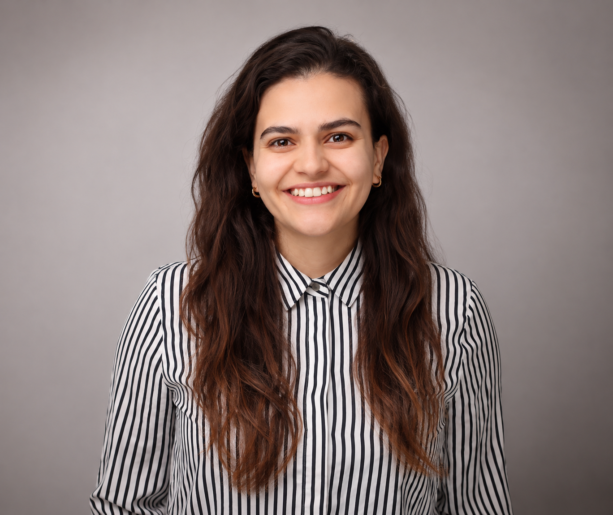

---
title: "About Me"
toc: false
page-layout: full
---

::: {.grid .about-intro}

::: {.g-col-12 .g-col-md-4}

{.about-photo}

:::

::: {.g-col-12 .g-col-md-8}

[POLITICAL SCIENCE · INTERNATIONAL AFFAIRS · DATA SCIENCE]{.project-category}

## Hello, I'm Erika.

I am a political scientist with a background in international affairs and data science, interested in understanding how political institutions, conflict, and social change shape people's lives.

My research interests have developed through academic study and professional experiences in peacebuilding and human rights, particularly in contexts affected by political violence and institutional challenges.

I am interested in bringing together political analysis and computational methods to investigate these questions from different perspectives, while keeping the social and political context at the center of my work.

:::

:::

::: {.about-details}

Academic Background

I studied Political Science at the Universidad Nacional de Colombia, where my interest in peace and conflict research developed through my involvement in initiatives related to Colombia's peace process. These experiences allowed me to engage with questions concerning armed conflict, political participation, and the challenges of building peace in territories affected by violence.

I subsequently completed a Master of International Affairs at the Hertie School in Berlin, specializing in human rights and broadening my understanding of international politics, institutions, and governance. More recently, I pursued a Master's degree in Data Science at Pontificia Universidad Católica de Chile, developing stronger skills in statistical analysis, programming, and computational approaches to social research.

Together, these academic experiences have shaped my interest in combining substantive political questions with empirical research methods.

Research, Professional Experience & Additional Training

My research and professional experience began in Colombia, where I worked on projects related to armed conflict, forced displacement, territorial peace, and the implementation of the peace agreement. At the National University of Colombia, I coordinated the Observatory of Local Actors for Territorial Peace, contributed to research on post-conflict processes, and participated in the socioeconomic census of FARC members during demobilization.

Later, in Germany, I was involved with CampusAsyl, an organization supporting refugees and asylum seekers in Regensburg. I subsequently joined the German Agency for International Cooperation (GIZ), where I conducted research and contributed to policy briefs supporting the German Federal Foreign Office's work on stabilization and peacebuilding in conflict-affected regions. My experience also includes human rights research and digital verification through Amnesty International's Digital Verification Corps.

### Additional Training

Alongside my academic degrees, I have pursued additional training in digital governance, geospatial analysis, human rights, and peace and conflict research. This includes a Certificate in Digital Governance from the Hertie School, training in Geospatial Information Technology in Fragile Contexts through the United Nations Institute for Training and Research (UNITAR), and a certification in the Protection of Women's Rights and the Legal Instruments for Measuring International Obligations, issued by the Latin American Council of Social Sciences (CLACSO).

Research Approach, Methods & Tools

My methodological experience includes statistical analysis, text mining, sentiment analysis, and geospatial analysis, using both qualitative and quantitative approaches. I primarily work with Python and R for data processing, analysis, and visualization, and have also gained experience with SQL, Tableau, and Databricks.

One aspect of research I particularly enjoy is working with visual information, whether through maps, charts, or interactive visualizations. Beyond presenting results, I see visualization as a valuable part of the analytical process, allowing me to explore patterns, examine relationships, and communicate complex findings in a more accessible way.

:::
