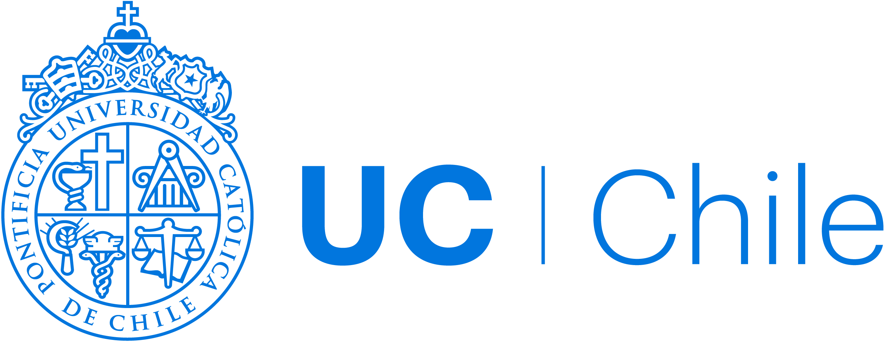
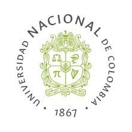

::: {.cv-intro}

Political scientist with an interdisciplinary background in international affairs and data science, and research experience in armed conflict, peacebuilding, human rights, and governance. My work combines empirical research and policy-oriented analysis with quantitative and computational methods.

:::

## Education

::: {.cv-education}

::: {.cv-education-entry}

::: {.cv-education-logo}

:::

::: {.cv-education-info}
**Master's Degree in Data Science**

Pontificia Universidad Católica de Chile

*September 2026*
:::

:::

::: {.cv-education-entry}

::: {.cv-education-logo}

:::

::: {.cv-education-info}
**Master of International Affairs**

Hertie School, Berlin, Germany

*June 2025*
:::

:::

::: {.cv-education-entry}

::: {.cv-education-logo}

:::

::: {.cv-education-info}
**Bachelor's Degree in Political Science**

National University of Colombia

*September 2015*
:::

:::
:::

## Research Methods & Technical Skills

::: {.skills-grid}

::: {.skills-column}

**Programming**  
Python, R, SQL

**Data Science & Machine Learning**  
Data preprocessing, exploratory data analysis (EDA), supervised and unsupervised learning, model evaluation

**Statistical Analysis**  
Regression analysis, survival analysis, statistical modelling

:::

::: {.skills-column}

**Data Visualization**  
Tableau, Power BI, Python and R visualization libraries

**Conflict Research & Analysis**  
Spatial conflict analysis, armed actor mapping, quantitative and qualitative research

**Platforms & Research Tools**  
Databricks, Apache Spark, SurveyMonkey, Quarto, Canva, Microsoft Office

:::

:::

## Research & Professional Experience

::: {.cv-experience}

### German International Cooperation Agency (GIZ)

**Policy Officer — Mediation, Peacebuilding, and Stabilization (Professional Year)**

*June 2023 – June 2024*

- Supported advisory services to the German Federal Foreign Office on stabilization and peacebuilding in conflict-affected regions.
- Conducted research and prepared policy briefs on peace negotiations and political stabilization.
- Developed a digital toolkit for verifying and monitoring information related to armed conflicts.

### CampusAsyl — Regensburg, Germany

**Project Assistant — Human Rights and Migration**

*August 2017 – December 2018*

- Supported administrative and organizational activities, as well as educational, artistic, and cultural projects for refugees and asylum seekers.

### National University of Colombia

**Consultant — Research Group on Territorial Development, Peace and Post-Conflict**

*December 2017 – February 2018*

- Advised on research projects monitoring the implementation of Colombia's peace agreement, particularly agrarian reform and the vulnerability of social activists.

**Coordinator — Observatory of Local Actors for Territorial Peace**

*December 2015 – October 2017*

- Led the monitoring and mapping of non-state armed actors during the Colombian peace process with the FARC.
- Supervised three regional data collection teams working in areas with significant armed actor presence.

**Consultant — Socioeconomic Census of FARC Members**

*May 2017*

- Surveyed and documented the socioeconomic profiles, expectations, and concerns of FARC members in Colombian penitentiaries as part of a census project supported by the Colombian Presidency and the United Nations.

**Facilitator — The End of Armed Conflict Forum**

*United Nations and National University of Colombia | February 2017*

- Supported the collection and compilation of 18 proposals from Afro-Colombian, Black, and ancestral communities concerning victims' rights and reparations, for submission to the peace negotiation team.

**Teaching Assistant — Faculty of Political Science**

*February – November 2016*

- Assisted in teaching seminars on the Economic and Political History of Colombia in the 19th and 20th centuries, as well as Introduction to Research.

**Researcher — Territorial Impacts and Reparation Project**

*April 2014 – December 2015*

- Collected and systematized academic, legal, and judicial information on territorial conflict dynamics, including forced displacement, paramilitarism, and the influence of non-state armed actors.
- Prepared periodic research reports based on the collected information.

**Academic Forum Coordinator — Public Policies and Territorial Peace in Colombia**

*September – November 2015*

- Coordinated the organization of the first academic forum on public policies and territorial peace, including guest communications, event logistics, and academic documentation.

**Student Researcher — Security and Defense Research Group**

*February 2013 – March 2014*

- Collected and analyzed newspaper coverage across five Colombian presidential administrations, examining political narratives surrounding forced displacement.

:::

## Certifications

::: {.cv-certifications}

**Certificate in Digital Governance**  
*Hertie School, Centre for Digital Governance | 2025*

**Certificate in Geospatial Information Technology (GIT) in Fragile Contexts**  
*United Nations Institute for Training and Research (UNITAR) | 2025*

**Certificate in Protection of Women's Rights: Instruments to Measure International Obligations**  
*Latin American Council of Social Sciences (CLACSO) | 2021*

:::

## Additional Training & Academic Engagement

::: {.cv-training}

**Peace and Conflict School — Summer School**  
*Istanbul Peace Research Center (IPRC) | May 2026*

**Digital Verification Corps**  
*Amnesty International | October 2024 – April 2025*

Digital verification and geolocation of human rights violations in Germany, Lebanon, Iran, and South Sudan.

**Basic SQL & Statistics for R**  
*Codecademy | February 2024*

**Workshop in Political Education**  
*German Federal Office for Family and Civil Society Affairs | July 2018*

**International Conference on Public Policy (ICPP) — Conference Presentation**  
*Singapore | June 2017*

Presented “Polarization and Controversy: Effects of Narrative Strategies in Peacebuilding Policy (Colombia).”

**Peace Processes Course**  
*Office of the High Commissioner for Peace, Colombia | March 2016*

:::

## Publications & Contributions

**Ortiz, E., Dornelles, R., & Wang, Y. (2025, April 25).**  
[How AI can tackle disinformation in Latin America](https://www.hertie-school.org/en/digital-governance/research/blog/detail/content/how-ai-can-tackle-disinformation-in-latin-america). *Hertie School Centre for Digital Governance.*

**Ortiz Pedraza, E. J. (2018).**  
[Von Ronaldo, Messi und Hemingway – Sport, Spiel & Spaß in der Erstaufnahme](https://web.archive.org/web/20230126221641/https://www.campus-asyl.de/von-ronaldo-messi-und-hemingway-sport-spiel-spass-in-der-erstaufnahme/). *CampusAsyl e.V.*

**Ortiz Pedraza, E. J., Sánchez Isaza, S. M., & Guzmán Medrano, D. E. (2012).**  
[Representaciones de la población desplazada por la violencia en la escena política colombiana](https://derecho.bogota.unal.edu.co/fileadmin/publicaciones/Semilleros/LibrosSemilleros/2012/Semilleros_2012-8.pdf). *Universidad Nacional de Colombia, Semilleros de Investigación, No. 27.*

## Languages

::: {.columns}

::: {.column width="33%"}
**Spanish**  
Native
:::

::: {.column width="33%"}
**English**  
C1
:::

::: {.column width="33%"}
**German**  
C1
:::

:::
