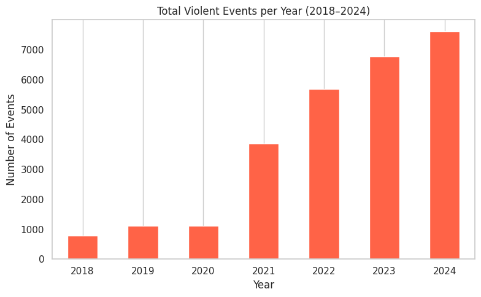

---
title: "Patterns of Armed-Conflict Violence in Colombia"
subtitle: "Exploratory Data Analysis | 2018–2024"
toc: true
---

## Project Overview

This project explores patterns of armed-conflict violence in Colombia between 2018 and 2024.

Using a database of recorded violent events, the analysis examines temporal variation, the frequency of different types of violence, geographic distributions, and relationships between violence categories and associated armed groups.

The objective is to describe patterns in the available records and identify questions for further investigation.

## Data and Scope

The exploratory analysis covers recorded events between 2018 and 2024.

The dataset was filtered to 21 selected subcategories of violence, including selective homicides, forced displacement, threats, massacres, kidnapping, enforced disappearance, and other forms of conflict-related violence.

The analysis uses event counts and categorical comparisons. These should be interpreted as patterns within the available records rather than complete measures of conflict-related violence.

## Exploratory Analysis

### 1. Temporal Distribution of Violence

The annual distribution of recorded violent events provides an initial overview of how the number of observations in the dataset varies between 2018 and 2024.

{#fig-colombia-annual width="90%" fig-align="center"}

The annual distribution shows a marked increase in recorded events between 2018 and 2024. While the number of observations remained relatively stable from 2018 to 2020, it rose substantially from 2021 onward, reaching its highest level in 2024.

These figures describe the distribution of records within the analyzed dataset. They should not be interpreted as evidence of an equivalent increase in the overall incidence of conflict-related violence without assessing changes in reporting coverage and data collection.

### 2. Types of Violence

Which categories of violence were most frequently recorded?

The analysis compares the frequency of the selected violence subcategories.

### 3. Geographic Distribution

How are recorded violent events distributed across Colombian departments?

This section examines departmental variation and the distribution of violence types across territories.

### 4. Armed Groups and Types of Violence

How do recorded violence categories vary across associated armed groups?

The analysis uses cross-tabulations, heatmaps, and an interactive Sankey diagram to explore these relationships.

## Discussion

This section will synthesize the main descriptive patterns, discuss limitations of the dataset, and identify questions for further research.
