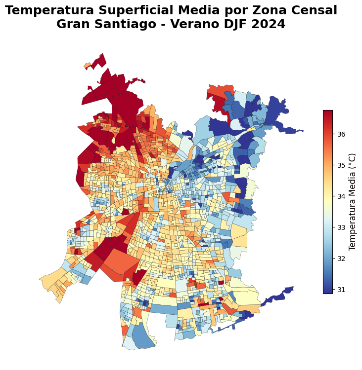

---
title: "Urban Heat Islands and Spatial Vulnerability in Santiago"
subtitle: "Satellite Imagery, Spatial Statistics, and Demographic Analysis"
toc: true
---

## Project Overview

This project examines the spatial distribution of land surface temperature in Greater Santiago, Chile, during summer 2024, and explores its relationship with the distribution of older residents.

Using Landsat 8 satellite imagery, 2024 census data, and spatial statistical methods, the analysis identifies patterns of thermal clustering and compares them with areas containing higher proportions of residents aged 60 and over.

The project was developed as part of the Geospatial Data Science course at Pontificia Universidad Católica de Chile.

## Research Questions

- How is land surface temperature distributed across Greater Santiago?
- Are there statistically significant spatial clusters of high and low temperatures?
- How does the distribution of thermal hot spots compare with the spatial concentration of older residents?

## Data and Methods

The analysis combines:

- Landsat 8 Collection 2 Level-2 imagery
- Google Earth Engine for satellite-image processing
- Chilean 2024 census cartography and demographic data
- Geographic information processing with GeoPandas
- Global Moran's I for spatial autocorrelation
- Local Moran's I (LISA) for cluster identification
- Spatial comparison of thermal and demographic hot spots

## Selected Visualizations

### Spatial Distribution of Land Surface Temperature

The following map illustrates the spatial distribution
of land surface temperatures across Greater Santiago.

{#fig-santiago-temperature width="90%" fig-align="center"}

## Findings

The analysis identifies a spatial contrast between thermal hot spots, concentrated primarily in western Greater Santiago, and areas with higher proportions of older residents, more prominent toward the eastern part of the city.

The limited overlap between these patterns suggests that thermal exposure and demographic vulnerability have distinct spatial distributions.
